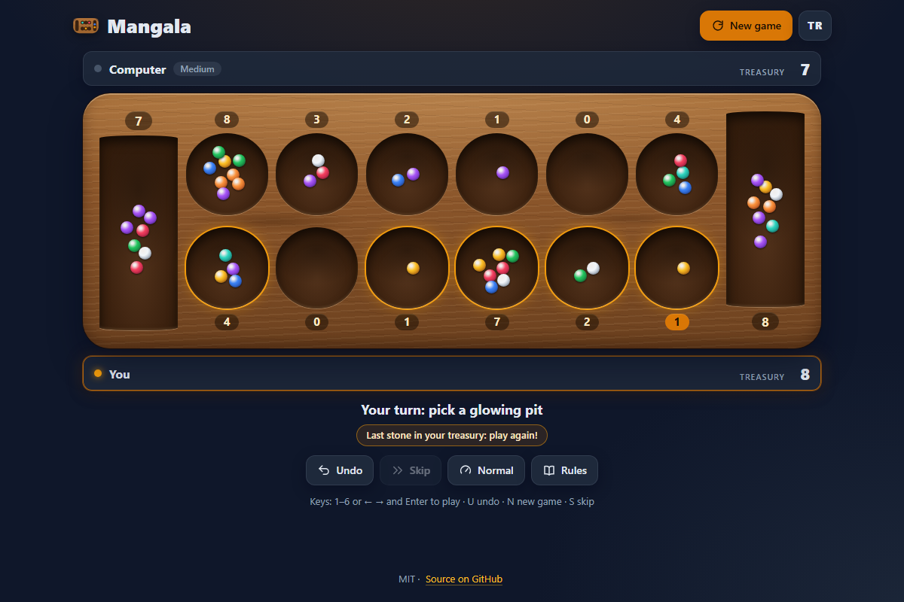

# Mangala - the traditional Turkish mancala game in your browser

[](#tests)
[](LICENSE)

**▶ Play now: https://celaldrg.github.io/mangala/**



## Features

- The real Turkish rules: first stone back into the pit, single-stone move, extra turn in your
  treasury (hazine), even captures, empty-pit captures and the end-of-game sweep.
- Play the computer on three levels (an alpha-beta search that plans around extra turns and stops
  deepening after 150 ms, so slow phones never stall), with you or the computer starting, or play a
  friend on one device.
- Warm wooden board drawn in CSS with colourful glass stones; every move is sown stone by stone,
  with a speed setting (slow, normal, fast, instant; fast by default when your system asks for
  reduced motion) and a skip button.
- Playable pits glow, hovering or focusing a pit marks where its last stone will land, and
  captures, extra turns and the final sweep are announced.
- Undo, a Rules dialog with the Turkish terms, and English and Turkish text (your choice is saved).
- Works on phones and desktops, with touch, mouse and keyboard. No build step, no dependencies,
  nothing loaded from other sites.

## How to play

Each player owns six pits (kuyu) in the row in front of them and the treasury on their right.
Every pit starts with 4 stones. On your turn pick one of your pits: the stones are sown
counter-clockwise, the first one back into the same pit, one per pit after that, including your
own treasury but never your opponent's. A pit holding a single stone just passes it to the next pit.

- Last stone in your treasury: play again.
- Last stone makes an opponent's pit even: you take that pit.
- Last stone lands in one of your empty pits while the pit opposite holds stones: you take both.
- When one side runs out of stones the game ends; the player whose pits ran out takes every stone
  left on the other side. The fuller treasury wins.

**Touch / mouse:** tap a glowing pit to play it. Tap the board during an animation to skip it.
**Keyboard:** `1`-`6` play a pit from the left, `←` `→` move between pits and `Enter` plays the
focused one, `U` or `Ctrl+Z` undo, `N` new game, `S` or `Esc` skip the animation.

## Run locally

The page uses ES modules, which browsers only load over `http://`, not from `file://`. Serve the
folder with any static server, for example:

```sh
npx serve .
```

and open the address it prints. Add `?demo` to the URL for the fixed mid-game position used for
the screenshot.

## Tests

```sh
node --test
```

Node 22 or newer, no packages to install. The suites cover every rule (sowing, single stone,
skipping the opponent's treasury, both captures, extra turn, sweep, winner), 1000 seeded random
games that never lose a stone and always end, the computer player (captures, extra turns, alpha-beta
equals minimax, repeatable per seed, the time limit), the game controller and undo, the animation
frames, the demo position, both languages (same keys and placeholders, "1 stone" but "2 stones",
every key the page uses exists), the status messages, settings (validation, who starts, reduced
motion), the storage fallbacks for private mode, the stone layout and a few source checks (only
local files, no `eval` or `innerHTML`).

## Project structure

```text
index.html         page, dialogs and meta tags
style.css          dark theme, wooden board, responsive layout
src/
  rules.js         board, sowing, captures, end of game (pure)
  ai.js            computer player, alpha-beta search (pure)
  game.js          turns, computer moves and undo (pure)
  frames.js        a move as animation frames (pure)
  messages.js      status and event messages (pure)
  settings.js      preferences and their validation (pure)
  stones.js        where each stone sits, and its colour (pure)
  demo.js          the ?demo position (pure)
  rng.js           seeded random numbers (pure)
  i18n.js          English and Turkish strings
  storage.js       localStorage wrapped in try/catch
  view.js          the board on screen
  dialogs.js       New game and Rules dialogs
  main.js          entry point: input, turn flow, animation
test/              node:test suites
docs/              screenshot
```

## License

[MIT](LICENSE) © 2026 Celalettin Durgaç

## Türkçe

Mangala, iki kişiyle oynanan geleneksel Türk zekâ ve strateji oyunu; tarayıcıda, kurulum
gerektirmeden.

**▶ Hemen oyna: https://celaldrg.github.io/mangala/**

### Özellikler

- Gerçek Türk kuralları: ilk taş aynı kuyuya, tek taş bir sonraki kuyuya, son taş hazineye düşerse
  ekstra tur, çift yakalama, boş kuyu yakalama ve oyun sonunda kalan taşların toplanması.
- Üç seviyeli bilgisayar rakip (ekstra turları hesaba katan alfa-beta araması; 150 ms'den sonra
  derinleşmeyi bırakır, yavaş telefonda da takılmaz), kimin başlayacağı seçilebilir; ya da aynı
  cihazda iki oyuncu.
- CSS ile çizilmiş sıcak ahşap tahta ve renkli cam taşlar; her hamle taş taş dağıtılır, hız ayarı
  (yavaş, normal, hızlı, anında; sistem hareketin azaltılmasını isterse varsayılan hızlı) ve atlama
  düğmesi vardır.
- Oynanabilen kuyular parlar; bir kuyunun üstüne gelince son taşın düşeceği yer işaretlenir;
  yakalamalar, ekstra turlar ve oyun sonu duyurulur.
- Geri al, Türkçe terimlerle kurallar penceresi, İngilizce ve Türkçe arayüz (seçim kaydedilir).
- Telefonda ve bilgisayarda dokunma, fare ve klavyeyle oynanır; derleme adımı ve bağımlılık yok,
  başka sitelerden hiçbir şey yüklenmez.

### Nasıl oynanır

Her oyuncunun önündeki sırada altı kuyusu ve sağında bir hazinesi vardır; her kuyuda başta 4 taş
bulunur. Sıra sendeyse kendi kuyularından birini seç: taşlar saat yönünün tersine dağıtılır, ilki
aynı kuyuya, sonra her kuyuya bir taş; kendi hazinene de taş bırakırsın, rakibin hazinesi atlanır.
Kuyuda tek taş varsa o taş bir sonraki kuyuya geçer.

- Son taş kendi hazinene düşerse bir kez daha oynarsın.
- Son taş rakibin bir kuyusunu çift yaparsa o kuyudaki taşları alırsın.
- Son taş kendi tarafındaki boş bir kuyuya düşer ve karşısındaki kuyuda taş varsa ikisini de alırsın.
- Bir taraftaki kuyular boşalınca oyun biter; kuyuları boşalan oyuncu karşı tarafta kalan bütün
  taşları alır. Hazinesi dolu olan kazanır.

**Dokunma / fare:** parlayan bir kuyuya dokun. Animasyon sırasında tahtaya dokunmak animasyonu atlar.
**Klavye:** `1`-`6` soldan bir kuyuyu oynar, `←` `→` kuyular arasında gezer, `Enter` seçili kuyuyu
oynar, `U` ya da `Ctrl+Z` geri alır, `N` yeni oyun açar, `S` ya da `Esc` animasyonu atlar.

### Yerelde çalıştırma

Sayfa ES modülleri kullanır; tarayıcılar bunları `file://` ile değil, yalnız `http://` üzerinden
yükler. Klasörü herhangi bir statik sunucuyla aç, örneğin `npx serve .`, sonra yazdığı adrese git.
Ekran görüntüsündeki sabit oyun ortası konumu için adresin sonuna `?demo` ekle.

### Testler

`node --test` (Node 22 ya da üstü, kurulacak paket yok). Testler bütün kuralları, 1000 rastgele
oyunu (hiç taş kaybolmaz, her oyun biter), bilgisayar rakibini (süre sınırı dahil), geri almayı,
animasyon karelerini, demo konumunu, iki dilin eksiksizliğini (İngilizcede tekil/çoğul dahil),
mesajları, ayarları, gizli modda depolamayı ve taş yerleşimini kapsar.

### Lisans

[MIT](LICENSE) © 2026 Celalettin Durgaç
